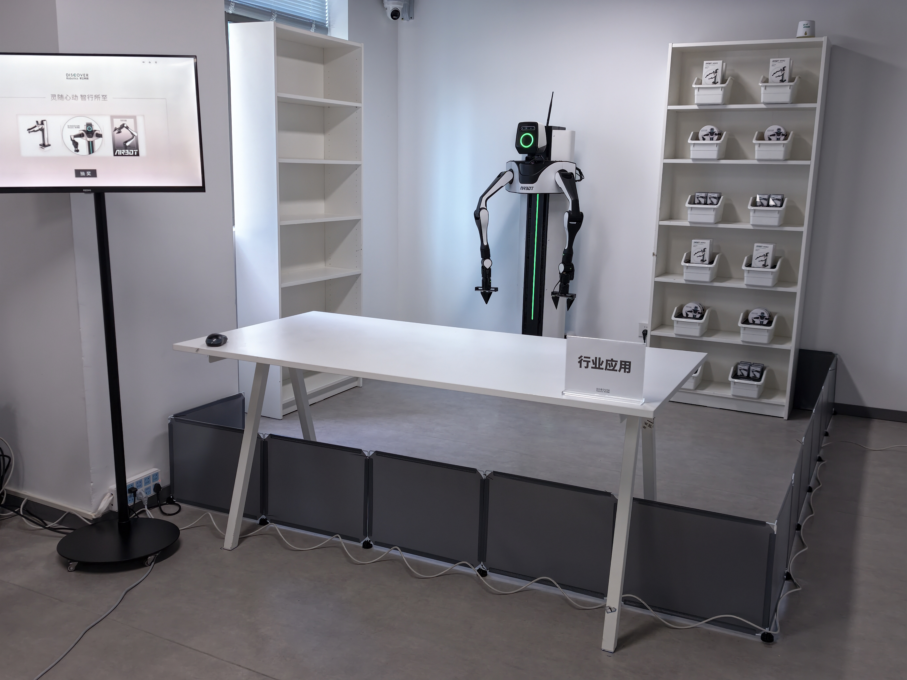
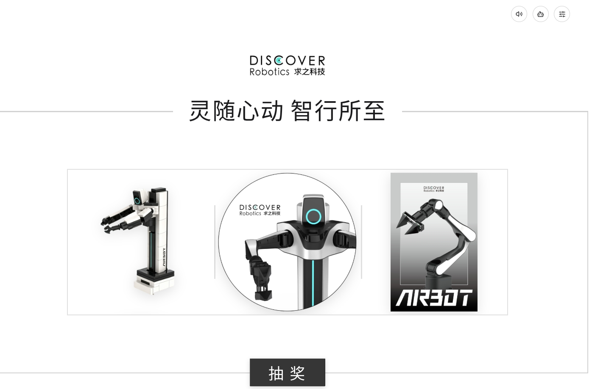
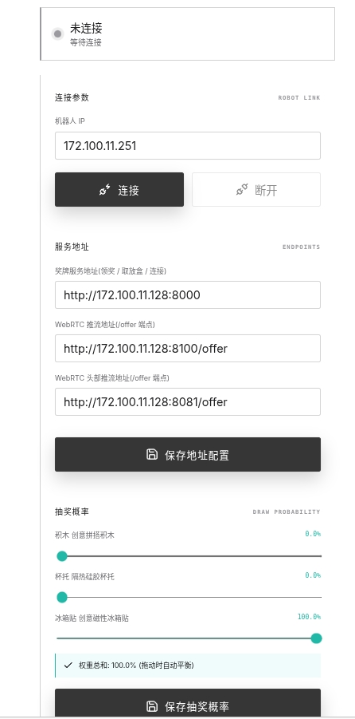
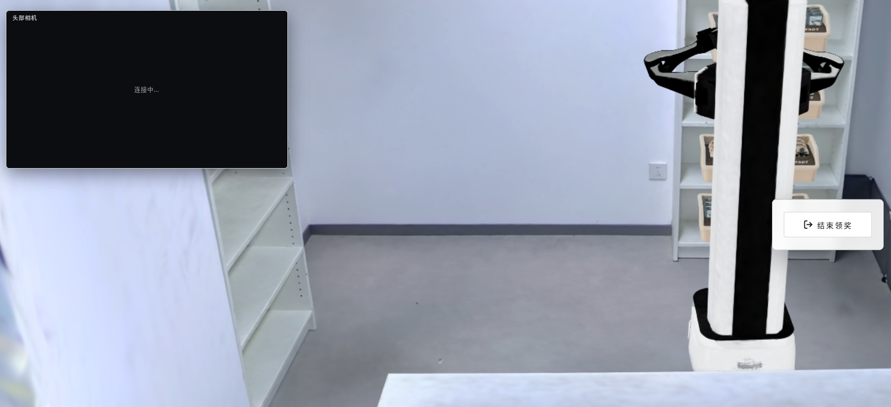
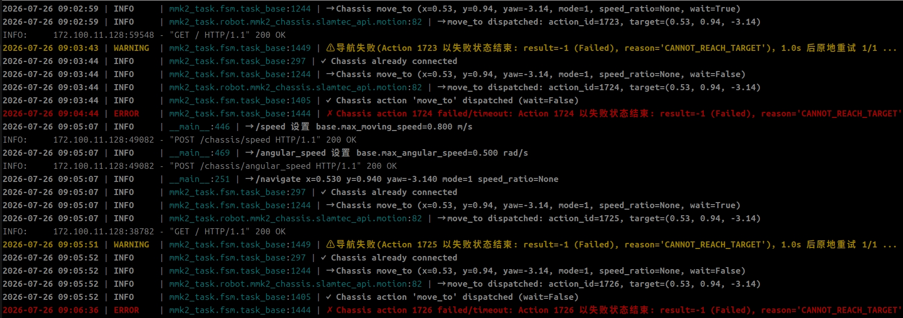

# MMK2 IROS 智能发奖 Demo

[English](README.md) | [简体中文](README.zh-CN.md)

基于 MMK2 移动双臂机器人的交互式发奖演示，包含智能发奖、取放奖牌盒和自动回充任务。本仓库整理原始演示场景的部署与提测说明，不是通用自主配送系统。



## 资料范围

本仓库公开整理后的文档、6 张原始参考图片和较小的部署辅助文件。约 14.4 GB 的 Docker 镜像、应用源码、SDK wheel、终端安装包、第三方底盘 App 和展厅导航地图**不存储在 Git 中**。

原文中的 `/home/discover/mmk2_iros_demo/mmk2-iros` 是部署机器的本地目录，不是公开源码仓库。执行安装命令前，请向 Demo 维护人员取得匹配的部署包，不要替换为其他 MMK2 版本的流程。

## 硬件与安全

| 项目 | 原始配置 |
| --- | --- |
| 机器人 | 1 台 MMK2，包含双臂、夹爪和移动底盘 |
| 奖品盒 | 12 个，22 × 15 × 10.5 cm，壁厚 0.2 cm |
| 主机 | 配备 NVIDIA GPU 的 Linux 工作站 |
| 网络 | 主机能够访问机器人和 OrangePi 控制器 |

连接机器人或重启服务前，确认机器人 IP、控制器地址、场地地图和目标地点，检查夹爪中是否有物体。清空双臂、脊柱和底盘运动范围，并确保急停可用。**启动或停止机械臂服务可能导致机械臂自动运动。** 全局重定位也会使底盘旋转。

## 软件版本基线

本说明对应提测文档 **V0.2.0（2026-07-27）**，以及构建于 2026-07-27 的 Docker 镜像 **`mmk2-iros-demo:1.0`**。

| 组件 | 文档中的版本 |
| --- | --- |
| 系统 / Docker 基础镜像 | Ubuntu 22.04 |
| Python | 3.12 |
| Conda 环境 | `mmk2_iros`、`s2r_bridge` |
| MediaPipe | 0.10.21；原始宿主机流程安装时使用 `--no-deps` |
| MMK2 SDK wheel | `mmk2_sdk` 0.0.4.dev5，由部署项目的 `packages/` 提供 |
| 镜像内组件 | Gradio 5.49.1、Ultralytics 8.4.95、AV 14.2.0、MuJoCo 3.10、Torch 2.11+cu128、DISCOVERSE 1.6.2、通过 RoboStack 安装的 ROS 2 Jazzy |

原始最低主机要求：8 核 CPU、16 GB 内存、40 GB 磁盘、RTX 30/40 系列 GPU 和 6 GB 显存、535.x 或更新驱动、Docker 20.10 或更新版本、NVIDIA Container Toolkit。推荐：12 核以上、32 GB 内存、60 GB 以上磁盘、RTX 3090/4090 和 12 GB 以上显存、570.x 或更新驱动。加载及解压镜像时请额外预留足够空间。

## 部署

### 已部署的宿主机

原始说明中，已配置好的演示主机通过 `mmk2-sim` 和 `mmk2-app` 开机自启动。请取得匹配的奖品领取终端安装包。Ubuntu 原始安装命令：

```bash
sudo dpkg -i mmk2-award-terminal_0.1.0_amd64.deb
```

Windows 使用 0.1.0 版本终端安装程序。本仓库不分发这两份安装包。

### Docker 部署

部署辅助文件已放在 [`deployment/`](deployment/) 中。请单独下载 Docker 镜像，将它与校验文件放在同一目录后执行以下命令。镜像约 14.4 GB，因此不存储在 Git 中。

### 下载 Docker 镜像

从 [image-v1.0 Release](https://github.com/DISCOVER-Robotics/MMK2-IROS-Demo/releases/tag/image-v1.0) 下载 **全部 8 个分卷（`part-00` 至 `part-07`）** 和两份校验文件。每份均小于 GitHub 单附件 2 GiB 限制；分卷不是独立 Docker 镜像，不能单独加载。

将下载文件放在同一目录，在 Linux 中执行以下命令。分卷与合并文件至少需要约 29 GB 可用空间，Docker 解压加载还需额外空间。若已有同名镜像文件，请先检查，避免覆盖。

```bash
sha256sum -c mmk2-iros-demo-1.0-parts.sha256
cat mmk2-iros-demo-1.0.tar.zst.part-{00..07} > mmk2-iros-demo-1.0.tar.zst
sha256sum -c mmk2-iros-demo-1.0-local.sha256
```

所有校验均显示 `OK` 后再继续。从 `deployment/` 取得下方脚本并放在同一目录。校验仅确认下载文件与提供的文件一致，不证明硬件兼容性或镜像来源真实性。

| 文件 | 用途 |
| --- | --- |
| [`mmk2-check-env.sh`](deployment/mmk2-check-env.sh) | 环境及端口检查脚本 |
| [`mmk2-docker-run.sh`](deployment/mmk2-docker-run.sh) | 容器启动脚本 |
| [`mmk2-iros-demo-部署指南.md`](deployment/mmk2-iros-demo-部署指南.md) | 完整部署指南 |
| [`README-快速部署.txt`](deployment/README-快速部署.txt) | 快速参考 |
| [`mmk2-iros-demo-1.0-local.sha256`](deployment/mmk2-iros-demo-1.0-local.sha256) | 本次提供镜像的 SHA256 |

在镜像所在目录执行：

```bash
chmod +x mmk2-check-env.sh mmk2-docker-run.sh
./mmk2-check-env.sh
sha256sum -c mmk2-iros-demo-1.0-local.sha256
zstd -dc mmk2-iros-demo-1.0.tar.zst | docker load
docker images mmk2-iros-demo:1.0
```

部署文件中附带的原始校验值与提供的镜像不一致，原因尚未确认。原文件已保留为 [`mmk2-iros-demo-1.0-upstream.sha256`](deployment/mmk2-iros-demo-1.0-upstream.sha256) 供追溯；当前提供的镜像请使用 `local` 校验文件。

完成真机安全检查后，用实际机器人地址启动（替换示例地址 `192.168.1.100`）：

```bash
NETWORK_MODE=host ROBOT_IP=192.168.1.100 ./mmk2-docker-run.sh
```

原始脚本还支持通过 `ENABLE_REALSENSE=true` 启用真实相机。网络和相机配置以配套部署指南为准，不要直接沿用截图地址。

## 演示操作

1. 打开奖品领取终端应用。
2. 点击右上角中间按钮进入机器人配置，填写机器人 IP、API 地址和视频端点，保存后连接机器人。
3. 设置并保存抽奖概率，返回主页面。
4. 点击抽奖，等待机器人取出奖品并完成交互。结束领奖后再开始下一轮。
5. 同一类别的两箱道具全部取完后，人工补货并恢复场景。**断开并重新连接机器人**，刷新任务与仿真状态。








截图保留原始中文界面和示例地址；仓库默认文档为英文版。

## 服务与排查

| 服务 | 文档中的端点 |
| --- | --- |
| 机械臂 gRPC | 机器人端口 `50055` |
| 底盘 HTTP | 控制器端口 `8800` |
| 灯光 HTTP | 控制器端口 `8810` |
| Gradio | `http://<HOST>:7860` |
| FastAPI / Swagger / OpenAPI | `http://<HOST>:8000`、`/docs`、`/openapi.json` |
| 仿真 WebRTC | `http://<HOST>:8100`，配置截图使用 `/offer` |
| 头部相机 WebRTC | `http://<HOST>:8081`，配置截图使用 `/offer` |

原始网络表仅列出视频端口 8081，但 Docker 说明及界面还使用 8100。请核对实际服务配置和启动脚本中的端口映射，不要直接混用不同表格。

对于已有 systemd 部署的主机，完成安全检查后执行：

```bash
sudo systemctl restart mmk2-sim
sleep 5
sudo systemctl restart mmk2-app
journalctl -u mmk2-sim -u mmk2-app -f
```

重启后重新连接机器人。原始日志目录为 `/home/discover/mmk2_iros_demo/mmk2-iros/logs`，文档注明每 7 天清理。Docker 部署使用 `docker logs -f mmk2_demo` 和 `docker exec mmk2_demo nvidia-smi`，不要假定宿主机存在相同的 systemd 服务。

| HTTP 状态码 | 预期含义 |
| --- | --- |
| `202` | 任务已接受，在后台执行 |
| `409` | 已有互斥任务运行 |
| `422` | 任务或参数非法，如缺少 `prize_class`、行号不在 1–3、`auto_charge` 带有 `prize_class` |
| `503` | 尚未连接机器人 |

遇到 `gladLoadGL failed` 时检查 `MUJOCO_GL=egl` 和 GPU 驱动；GPU 不可用时检查 NVIDIA Container Toolkit；真机连接失败时检查机器人地址和 gRPC 端口。原始镜像缺少 Git，原文不建议在容器中重新安装 editable 包，开发应在宿主机进行。

## 底盘地图与定位

使用经过现场确认的地图，单独取得匹配的思岚 App。本仓库不公开展厅地图或第三方 APK。

原始现场流程：使用底盘电源键关机再开机，清空运动范围后解除刹车/急停，连接底盘 Wi-Fi，通过 App 连接 `192.168.11.1:1445`。上传已确认的场地地图并核对是否正确。执行全局重定位时底盘会旋转，必须确保周围安全；原文以该场景定位质量大于 90 为成功标准。



对于 `CANNOT_REACH_TARGET`，原文列出的可能原因包括地图中的虚假障碍物和电机故障。修改地图前检查实际场地，不要为了强行通行而删除真实安全障碍物。

## 参考与范围说明

| 资源 | 位置 / 可用性 |
| --- | --- |
| 产品文档 | [DISCOVER Robotics 文档中心](https://docs.discover-robotics.com/document/) |
| 原始部署参考 | [飞书部署文档](https://w79rvfxw83.feishu.cn/docx/TmDudmBTqoUlzRx5bXrcNbOjnNb)；发布检查时无法访问，可能受权限限制 |
| 源码与部署目录 | 原始主机的 `/home/discover/mmk2_iros_demo/mmk2-iros`，不是公开下载地址 |

内容、图片和部署辅助文件整理自 `MMK2 IROS Demo 提测文档.zip` 及 `mmk2镜像部署相关文件`。版本及命令反映提供的资料，不代表本次完成真机验证；整理期间未启动机器人服务。本资料仓库不声明应用源码的开源许可，也不声明第三方安装包的再分发权限。
